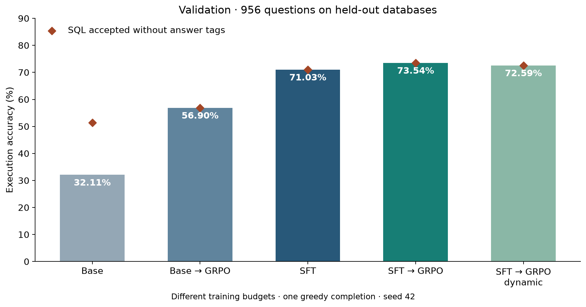
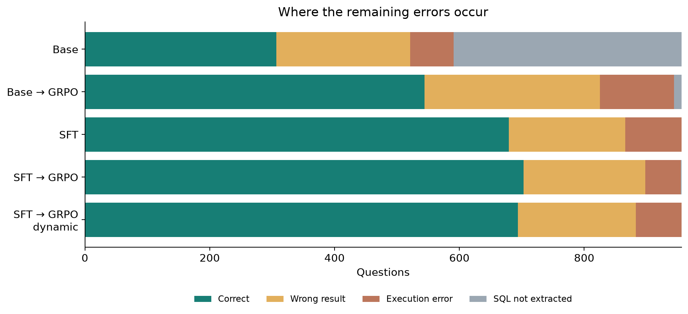

# Text-to-SQL · SFT и GRPO на Qwen3.5-2B

Исследование дообучения Qwen3.5-2B для генерации SQL по вопросу и схеме SQLite.
Сравниваются исходная модель, LoRA SFT, GRPO от исходной модели и GRPO после SFT.
Обучение выполнялось на бесплатных NVIDIA T4 в Kaggle, эксперименты и снимки
адаптеров сохранялись в Comet ML.

**Лучший результат на validation — 73,54% execution accuracy после SFT → GRPO,
против 71,03% у SFT.** GRPO исправил 49 ошибок SFT и потерял 25 ранее верных
ответов. Прибавка составила 24 задачи из 956, или 2,51 процентного пункта.



## Результаты

| Ветка | Обучение | Верно / 956 | Execution accuracy | SQL без обязательных тегов |
|---|---|---:|---:|---:|
| Base | Исходные веса | 307 | 32,11% | 51,36% |
| Base → GRPO | 128 шагов, LR 1e-5 | 544 | 56,90% | 56,90% |
| SFT | 5819 вопросов, одна эпоха, 728 шагов | 679 | 71,03% | 71,03% |
| SFT → GRPO | 1024 шага, LR 2.5e-6 | **703** | **73,54%** | **73,54%** |
| SFT → GRPO, динамический отбор | 241 шаг, LR 2.5e-6 | 694 | 72,59% | 72,59% |

В каждой строке один greedy-ответ на вопрос, одинаковые инструкции, thinking off,
контекст 4096 и лимит ответа 1024 токена. Выборки разделены по базам.
Для основной метрики SQL извлекается из блока `<answer>`, выполняется в SQLite
и сравнивается с результатом эталона. Дополнительная метрика разрешает SQL
без тегов и показывает вклад соблюдения формата.

**Это результаты разработки на validation при seed 42.** По validation выбирались
параметры и чекпойнты. Бюджеты веток Base → GRPO и SFT → GRPO различаются.
Финальные оценки на `test_spider` и `test_bird` и повтор на другом seed ещё
не выполнены. Данные не устанавливают общий предел качества в 75%.

[Подробные эксперименты и ограничения](docs/experiments.md) ·
[Инструкция воспроизведения](docs/reproduction.md) ·
[Проверяемые результаты в JSON](results/published/summary.json)

## Что проверено

- SFT на эталонных SQL и GRPO с наградой за правильное выполнение и формат.
- Несколько learning rate, размер микробатча и накопление градиентов на T4.
- Обычный и динамический отбор групп при одинаковом потоке из 2048 вопросов.
  Динамический вариант затратил на 38% меньше времени обучения при потере
  девяти верных ответов.
- Четыре завершённые абляции состава данных и `loss_type` при одинаковом
  бюджете 384 шага. Стабильного преимущества обогащения ошибками SFT не найдено.
- Ручной разбор 50 случайно выбранных ошибок с выполнением SQL на реальных базах.

## Почему GRPO дал умеренную прибавку

Лучший SFT → GRPO исправил 49 ошибок и потерял 25 ранее верных ответов.
В группах ответов часто совпадали награды, а ручной аудит выявил
ошибки выбора колонок, значений и логики, для исправления которых
принятая награда даёт только итоговый сигнал.

Динамический отбор сэкономил время при снижении точности.
Смена loss и повышение доли ошибок SFT дали разнонаправленные результаты.
Прямой GRPO улучшил Base до 56,90%, но уступил SFT при своём коротком
128-шаговом бюджете. Это ограничивает выводы о возможностях RL без SFT.

[Наблюдения, объяснения и границы выводов](docs/experiments.md#почему-прирост-grpo-оказался-умеренным)
включают показатели групповых наград и результаты каждой абляции.

## Данные

| Выборка | Вопросов | Баз | Назначение |
|---|---:|---:|---|
| `train` | 5819 | 120 | SFT и GRPO |
| `validation` | 956 | 20 | Выбор параметров и анализ |
| `validation_fast` | 200 | 20 | Подвыборка validation для пилотов |
| `test_spider` | 1032 | 20 | Зарезервированная оценка на Spider dev |
| `test_bird` | 427 | 10 | Зарезервированная оценка на BIRD Mini-Dev |

ID, исключения и контрольные суммы JSON и SQLite зафиксированы в
[splits/v1.json](splits/v1.json). Пустые эталонные результаты исключены из train.
Правила фильтрации и оставшиеся ограничения описаны в
[протоколе данных](splits/README.md). Исходные датасеты загружаются отдельно
согласно условиям [Spider](https://yale-lily.github.io/spider) и
[BIRD](https://bird-bench.github.io/).

## Посмотреть результаты без GPU

В репозитории опубликованы метрики, ответы на вопросы, отчёты обучения
с историей шагов и ручная разметка ошибок. Веса, базы и секреты хранятся
отдельно от опубликованных результатов.

```bash
git clone https://github.com/dancravik/text2sql-grpo.git
cd text2sql-grpo
python -m pip install "matplotlib==3.11.1"
python scripts/build_results.py
```

Команда проверяет контрольные суммы доказательных файлов, ID, настройки и
метрики по сохранённым ответам. Затем строит шесть PNG-графиков и
`results/published/summary.json`. Для повторного выполнения SQL нужны SQLite-базы.



## Запуск на Kaggle

Готовые ноутбуки содержат установку проверенных версий зависимостей,
проверку CUDA/cuDNN, подключение данных и Comet.

| Этап | Ноутбук |
|---|---|
| Полный SFT | [kaggle_sft_full.ipynb](notebooks/kaggle_sft_full.ipynb) |
| Пилоты SFT → GRPO | [kaggle_sft_grpo.ipynb](notebooks/kaggle_sft_grpo.ipynb) |
| Продлённое обучение и оценка снимков | [kaggle_sft_grpo_extended.ipynb](notebooks/kaggle_sft_grpo_extended.ipynb) |
| Обычный / динамический отбор | [kaggle_grpo_sampling.ipynb](notebooks/kaggle_grpo_sampling.ipynb) |
| Абляции данных и loss | [kaggle_grpo_overnight.ipynb](notebooks/kaggle_grpo_overnight.ipynb) |
| Оценка сохранённых Base → GRPO | [kaggle_grpo_validation.ipynb](notebooks/kaggle_grpo_validation.ipynb) |

Часть ноутбуков восстанавливает конкретный исходный SFT из сохранённого архива
и проверяет SHA256 его весов. Доступ к приватному Comet и адаптерам потребуется
для воспроизведения именно этих запусков. Можно заново обучить SFT с теми же
настройками и сохранить его как отдельный эксперимент.
