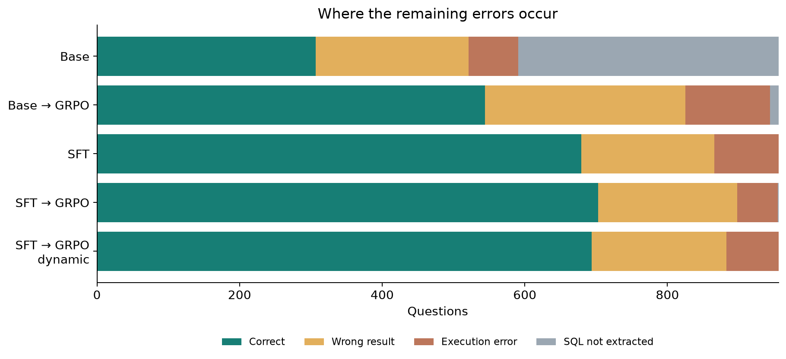
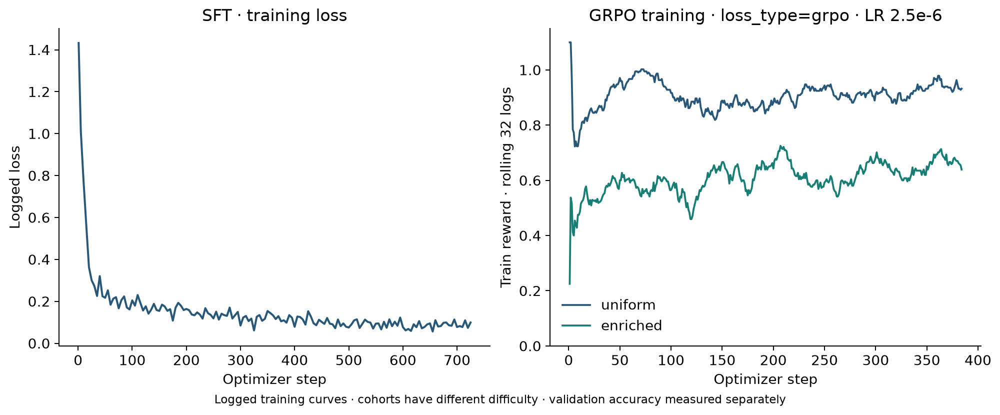
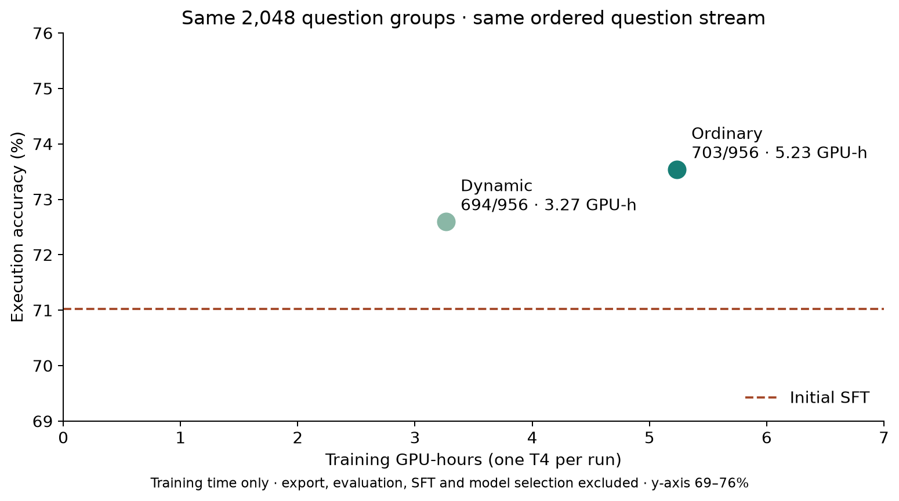
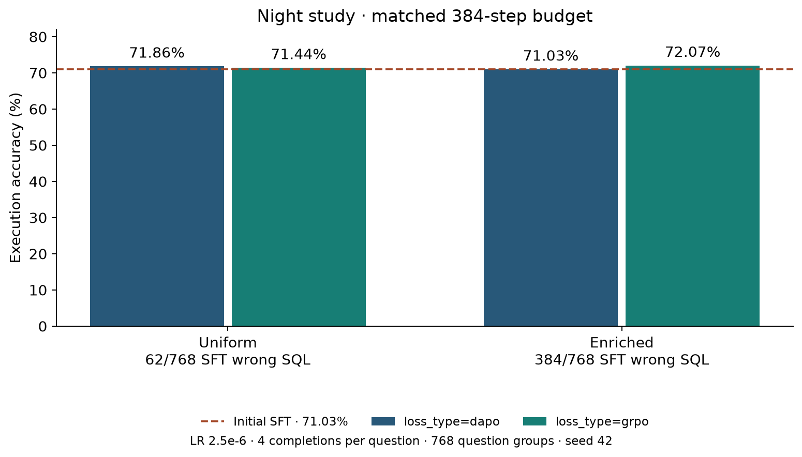
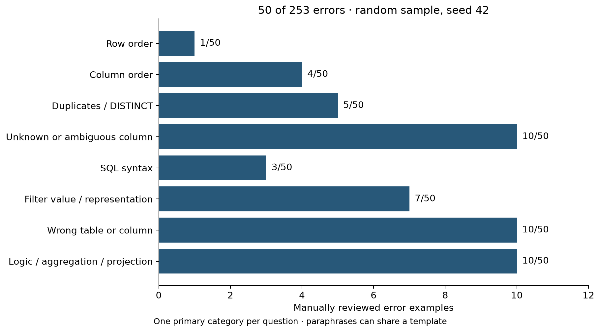

# Результаты экспериментов

Обновлено 27 ноября 2026. Все опубликованные числовые результаты ниже относятся
к validation из 956 вопросов. Это 20 баз, отделённых от train при фиксации
разбиения. Старые прогоны выбора исходной модели могли использовать эти
вопросы. Validation используется как выборка разработки.

## Протокол и метрики

Исходная модель — `Qwen/Qwen3.5-2B`, revision
`15852e8c16360a2fea060d615a32b45270f8a8fc`.
Manifest SHA256 —
`1c1c82fe943f872f786f47574ff804db2f57b893f8c3b0f611ff30c9848fc0db`.

Вход содержит инструкцию, схему SQLite и вопрос. При наличии evidence оно
также передаётся модели. Все сравниваемые генерации используют thinking off,
один greedy-ответ, seed 42, контекст 4096, максимум 1024 токена ответа.
Параметры оценки и ответы сохранены для каждой строки.

Основная метрика — strict greedy execution accuracy. Проверяющий извлекает
SQL из `<answer>...</answer>`, выполняет его на SQLite в режиме чтения
с таймаутом 5 секунд и лимитом 10 000 строк. При наличии `ORDER BY` в эталоне
сравнивается порядок строк, в остальных случаях — мультимножества строк.
Порядок колонок и количество повторов значимы. Функция награды даёт 1 за
совпадение результата и дополнительно 0,1 за формат.

Дополнительно считаются SQL без обязательных тегов, соблюдение формата,
SQL, который не удалось извлечь, ошибки выполнения, неверный результат,
длина ответа и обрезание по лимиту. В таблицах greedy accuracy обозначает
одну детерминированную попытку. Статистическая оценка sampled Pass@k требует
отдельных случайных генераций. Предложенная дополнительная оценка Pass@4
не имеет результатов в переданных артефактах.

## Основные ветки

| Ветка | Верно | Строгая accuracy | С допуском без тегов | SQL не извлечён | Ошибка выполнения | Неверный результат |
|---|---:|---:|---:|---:|---:|---:|
| Base | 307 | 32,11% | 51,36% | 365 | 70 | 214 |
| Base → GRPO | 544 | 56,90% | 56,90% | 12 | 119 | 281 |
| SFT | 679 | 71,03% | 71,03% | 0 | 90 | 187 |
| SFT → GRPO | 703 | 73,54% | 73,54% | 1 | 57 | 195 |
| SFT → GRPO, dynamic | 694 | 72,59% | 72,59% | 0 | 73 | 189 |

184 ответа Base дополнительно засчитаны мягким парсером. Следовательно,
часть преимущества SFT объясняется форматом. После допуска SQL без тегов
преимущество SFT над Base сохраняется и составляет 19,67 п. п.

SFT → GRPO исправил 49 ошибок SFT и потерял 25 ранее верных ответов.
Чистая прибавка — 24 задачи, или 2,51 п. п. Снижение числа ошибок выполнения
не устраняет ошибки логики. У лучшей модели остаются 195 исполняемых запросов
с неверным результатом.

## Обучение и выбор параметров

SFT использовал все 5819 train-вопросов в одной эпохе, 728 шагов без пропущенных
обновлений. LoRA rank 16, alpha 32, микробатч 1, gradient accumulation 8,
LR 1e-4, warmup 3%, линейное снижение LR, FP16 и gradient checkpointing.
Чистое время обучения составило 2,10 GPU-часа.

В предварительном LR-поиске на validation_fast из 200 вопросов LR 1e-4
и 2e-4 дали по 135 верных ответов, 5e-5 дал 127, 2.5e-5 дал 117.
Эти числа относятся к пилотам. Полный SFT выбран с LR 1e-4.
При проверке памяти микробатч 1 помещался, 2 давал OOM на длинных примерах.
Накопление градиентов позволило получить effective batch 8.

Для Base → GRPO после 128 шагов LR 1e-5 дал 544/956, LR 5e-6 дал 520/956.
Доступная обучающая подвыборка содержит 1024 вопроса. На шаг генерировались
четыре ответа для каждого из двух вопросов, microbatch 2, accumulation 4,
temperature 0,8, beta 0, постоянный LR. Время выбранного пилота — 0,59 GPU-часа.
Это бюджет одного выбранного обучения; стоимость поиска параметров
в него не включена.

После SFT проверялись LR 1e-5, 5e-6 и 2.5e-6, а также снимки на разных шагах.
В продлённой серии LR 2.5e-6 дал 671/956 на шаге 128, 687/956 на шаге 256
и 702/956 на шаге 512. Более поздний контрольный запуск на 1024 шага дал
703/956 при другом количестве доступных вопросов. Эти серии различаются
бюджетом и составом данных.

Левая панель показывает реальные логи train loss SFT. Правая — среднюю
train reward двух ночных GRPO-запусков со скользящим окном 32 записи.
Выборки справа различаются сложностью. Более высокая награда на более лёгкой
выборке сама по себе не устанавливает преимущество на validation.

В TRL 1.16.0 значение loss по умолчанию — `dapo`. В исторических отчётах без
явного `loss_type` использовался этот default закреплённой версии. Название
GRPO в основных ветках обозначает метод обучения с групповыми преимуществами.
В абляции ниже `dapo` и `grpo` обозначают конкретную нормировку loss.
Полная методика DAPO в проекте не воспроизводится.

## Отбор групп при одинаковом бюджете генерации

| Вариант | Вопросов / генераций | Шагов | Верно | Train GPU-часы |
|---|---:|---:|---:|---:|
| Обычный | 2048 / 8192 | 1024 | 703 | 5,23 |
| Динамический | 2048 / 8192 | 241 | 694 | 3,27 |

Оба запуска стартовали с одних SFT-весов и получили одинаковый упорядоченный
поток вопросов. LR 2.5e-6, четыре генерации на вопрос, beta 0.
Динамический вариант добирает группы с различающимися наградами до обновления
весов, максимум восемь раундов. Неиспользованные группы также входят в бюджет.
При нехватке активных групп предусмотрен ограниченный fallback.

Динамический вариант сэкономил 37,6% чистого времени обучения при потере
девяти верных ответов. Число обновлений у вариантов различается, число токенов
генерации также может различаться. GPU-часы в таблице исключают SFT, подбор,
экспорт, оценку и загрузки артефактов. Экономия измерена в этой паре запусков.

## Ночная абляция состава данных и loss

Все оценённые варианты стартовали с одного SFT, обучались 384 шага при
LR 2.5e-6, seed 42. Бюджет — 768 разных вопросов, четыре генерации на вопрос.
Случайная выборка содержит 62 вопроса, где исходный SFT дал исполняемый
неверный SQL. Обогащённая выборка содержит 384 таких вопроса. Общих вопросов
между выборками 446. Доли взяты из сохранённых отчётов отбора; индивидуальные
ответы train-аудита в переданных архивах отсутствуют.

| Данные | Loss | Верно | Accuracy | Исправлено / потеряно к SFT |
|---|---|---:|---:|---:|
| Uniform | dapo | 687 | 71,86% | 25 / 17 |
| Enriched | dapo | 679 | 71,03% | 30 / 30 |
| Uniform | grpo | 683 | 71,44% | 25 / 21 |
| Enriched | grpo | 689 | 72,07% | 42 / 32 |

Обогащение дало −8 задач при dapo и +6 при grpo. Замена dapo на grpo дала
−4 задачи на uniform и +10 на enriched. Однофакторное правило выбора здесь
не подтверждается. Один seed ограничивает уверенность в небольших различиях.

Сложные вопросы увеличили число групп со смесью верных и неверных SQL
с 199 до 222 при dapo и с 192 до 235 при grpo. Одновременно число групп
без верного SQL выросло с 62 до 261 и с 60 до 255. Эти счётчики определяются
правильностью SQL; бонус за формат тоже влияет на reward и advantage.

Статусы двух дополнительных запусков с LR 5e-6:

| Данные | Сохранено | Оценка |
|---|---|---|
| Uniform, grpo | Финальный адаптер шага 384 | Отсутствует |
| Enriched, grpo | Снимок шага 128 | Отсутствует |

Таким образом, завершены четыре из шести оценок. Изменение LR по этой серии
пока оценить нельзя. Снимок шага 128 нельзя считать завершённым запуском
на бюджете 384 шага. Файлы адаптеров сохранены отдельно от Git.

## Ручной анализ ошибок

Случайно выбраны 50 из 253 ошибок лучшего SFT → GRPO с seed 42.
Каждый вопрос, эталон, сгенерированный SQL и результат выполнения прочитаны
и размечены вручную одним проверяющим. Назначена одна основная категория,
дополнительные причины записаны в комментарии.

| Причина | Примеров |
|---|---:|
| Несуществующая или неоднозначная колонка | 10 |
| Неверный выбор таблицы или колонки | 10 |
| Логика, агрегация, состав результата | 10 |
| Значение фильтра или его представление | 7 |
| Повторы строк / DISTINCT | 5 |
| Порядок колонок | 4 |
| Синтаксис | 3 |
| Порядок строк | 1 |

Примеры включают исправление реальной опечатки схемы `asessment_outcome_code`
на несуществующее `assessment_outcome_code`, поиск `English` вместо
хранящегося `english`, а также `JOIN` после `WHERE`.
Ошибки встречаются на коротких вопросах с простым эталонным SQL.

В четырёх случаях результаты совпадают после перестановки колонок.
В одном совпадает мультимножество строк при различном порядке, хотя вопрос
явно не требует сортировки. В пяти различаются только повторы.
Нужность DISTINCT и требования к порядку требуют отдельной интерпретации.
Основная accuracy после разбора не пересчитывалась.
В выборке встречаются перефразировки одного шаблона; проценты относятся
к этим 50 вопросам, а не к независимым типам задач.
[Полная разметка всех примеров](../results/published/manual_error_audit.json).

## Ограничения и статус

- Результаты получены на validation. Финальные test_spider/test_bird зарезервированы,
  оценок по ним ещё нет.
- Выполнен один seed. Статистически устойчивый эффект между повторными
  обучениями не установлен.
- Лучшие Base → GRPO и SFT → GRPO различаются обучающим бюджетом. Прирост
  нельзя трактовать как сравнение при равных ресурсах.
- Validation уже использовалась при выборе гиперпараметров и в ранних прогонах
  выбора модели.
- Execution matching на одной базе допускает случайное совпадение результатов
  семантически разных запросов. Пустые эталонные результаты в validation
  сохранены и также допускают ложноположительные совпадения.
- Проверяющий учитывает порядок колонок, повторы и порядок строк при ORDER BY.
  Ручной аудит выявил спорные эталоны и неоднозначные формулировки.
- Пакет published содержит четыре полных ночных оценки. SQL-исходы всех
  3824 ответов независимо перепроверены на локальных SQLite.
  Последующая сборка графиков на CPU проверяет сохранённые метрики по ответам.
- Отсутствующие оценки и Pass@4 не заменяются предполагаемыми результатами.

Подтверждённый вывод состоит в том, что SFT обеспечил основной прирост качества,
а последующий GRPO улучшил validation accuracy на 2,51 п. п. в лучшей
конфигурации. Абляции показали чувствительность к бюджету, данным и loss.
Результат около 75% не устанавливает предел задачи или модели.
